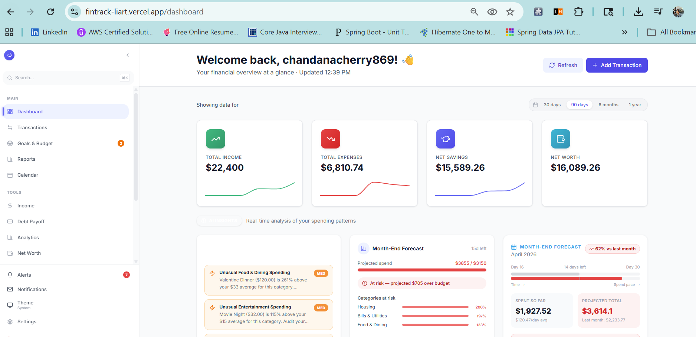
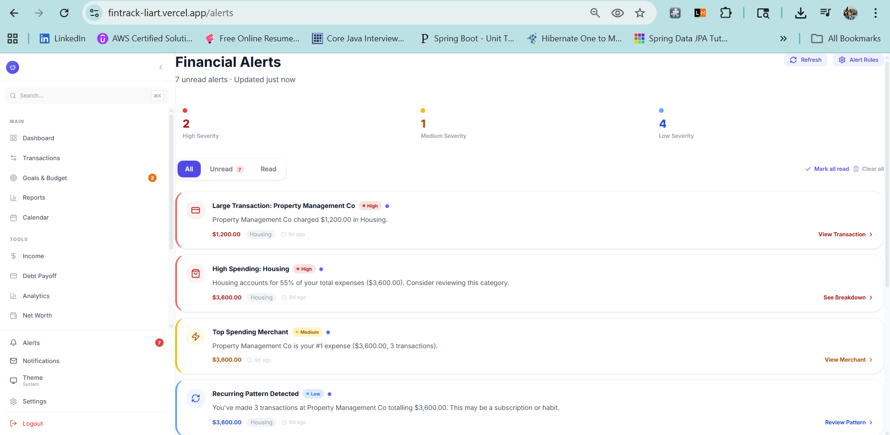
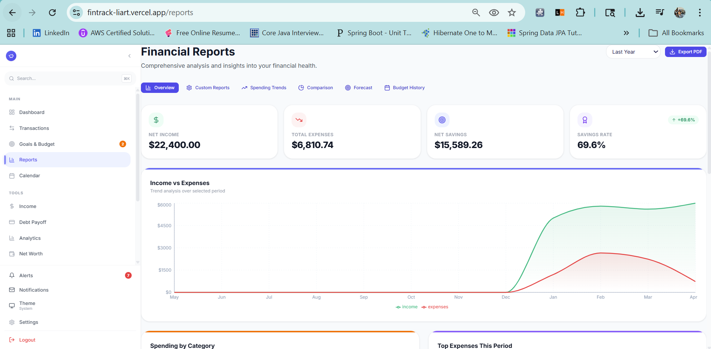
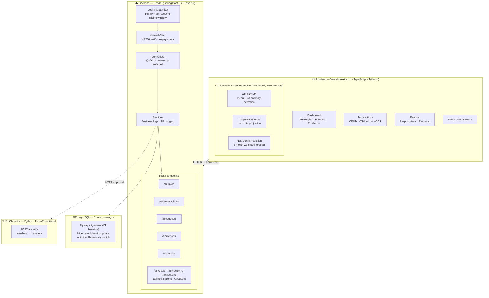

<div align="center">

# FinTrack — AI-Powered Personal Finance Platform

**Full-stack finance app with statistical anomaly detection, month-end budget forecasting, and smart alerts. Spring Boot + Next.js, deployed on Render and Vercel.**

[](https://fintrack-liart.vercel.app)

[](https://github.com/GanasalaChandana/FinTrack-AI-Powered-Personal-Finance-Platform/actions)
&nbsp;
[](https://spring.io/projects/spring-boot)
&nbsp;
[](https://nextjs.org/)
&nbsp;
[](https://github.com/GanasalaChandana/FinTrack-AI-Powered-Personal-Finance-Platform/actions)
&nbsp;
[](LICENSE)

</div>

---

## 🧠 Key Highlights

> What separates FinTrack from standard CRUD finance apps:

- **Statistical anomaly detection** — flags unusual spend using mean + 2σ per category. Runs 100% in the browser, zero API cost. This is rule-based analytics, not machine learning (see [Analytics Engine](#-analytics-engine-client-side-rule-based-zero-api-cost))
- **Next-month prediction** — 3-month weighted rolling average (weights 3-2-1) projects next month's income, expenses, and savings with trend momentum and a confidence rating
- **Predictive budget forecasting** — daily burn rate × days remaining = end-of-month projection with per-category "at risk" warnings
- **Spoof-resistant rate limiting** — sliding window per IP *and* per account, plus an app-wide sign-up cap, so a forged `X-Forwarded-For` can't dodge it. No Redis needed (`ConcurrentHashMap` + `Deque<Long>`)
- **Refresh token rotation with replay detection** — SHA-256 hashed, single-use; detecting a replayed token revokes ALL active sessions
- **Fail-fast security config** — the server refuses to start without a strong `JWT_SECRET` (and rejects known public example secrets); `/actuator` exposes only `health`; errors return generic messages, never internals
- **Ownership checks on user-scoped routes** — other users' resources return 403/404, and a `userId` supplied in a request body or query string is no longer trusted over the authenticated caller
- **100+ backend tests and 20+ frontend unit tests** — Mockito service tests, `@WebMvcTest` controller slices, and `@SpringBootTest` integration tests on in-memory H2 covering the security fixes; Vitest tests for the forecasting, anomaly and custom-report logic
- **Versioned database migrations** — Flyway baselines the live database and owns schema changes going forward; a test checks the baseline against the JPA entities

---

## 📸 Screenshots

| Dashboard + AI Insights | Smart Alerts | Reports & Forecast |
|:---:|:---:|:---:|
|  |  |  |
| AI anomaly cards + burn rate forecast visible above the fold | 8 rule types with severity badges and actionable context | 6-month spending forecast with trend line |

👉 **[Try the live demo → fintrack-liart.vercel.app](https://fintrack-liart.vercel.app)**

> ⏱️ **First load can be slow.** The backend runs on Render's free plan, which puts the server to sleep when idle. The first request after a quiet period can take 30+ seconds while it wakes up (the app shows a "waking up the server" message). After that it responds normally.

---

## 🎬 Demo

<div align="center">

[](https://fintrack-liart.vercel.app)

</div>

**Key flows to explore in the live app:**
- 🤖 **Dashboard → AI Insights row** — anomaly cards + burn rate forecast + next-month prediction
- 📊 **Reports tab** — nine report views (overview, custom, trends, comparison, forecast, budget history, tax, income, savings) built from your real transactions; the **Custom** view generates a report from the metrics, range and grouping you pick
- 🔔 **Alerts page** — smart rule-based alerts with severity badges; budget alerts are generated hourly by a background job
- 📥 **Transactions → Import CSV** — bulk upload with auto-tagging and payment methods read from the file; an unusable file never wipes existing data, and you get a real import result back
- 🧪 **Demo account** — try the app without signing up; the demo account is protected from deletion

---

## ✨ Features

| | Feature | What it does |
|---|---|---|
| 🤖 | **Anomaly Detection** | Statistical (mean + 2σ per category) — *"Housing ($1,200) is 277% above your $324 avg for this category"*. Needs a meaningful history in the category to fire |
| 🔮 | **Next-Month Prediction** | 3-month weighted forecast — *predicts income, expenses, savings rate with trend momentum and High/Medium/Low confidence* |
| 📈 | **Budget Forecasting** | Burn rate projection — *"On track to spend $3,855 vs $3,150 budget — $705 over. Housing at 200%."* |
| 🔔 | **Smart Alerts** | 8 rule types: large transactions, spending spikes, category concentration, income tracking |
| 🔄 | **Recurring Detection** | Levenshtein similarity matching identifies subscriptions and projects future bills |
| 🧾 | **Receipt Scanner** | Camera/file upload → Tesseract.js OCR extracts merchant, amount, date |
| 📊 | **Interactive Reports** | Nine report views: overview, custom, trends, comparison, 6-month forecast, budget history, tax, income, savings. Safe CSV / Excel / PDF exports (no third-party CDN scripts) |
| 💳 | **Payment Methods** | Transactions carry a payment method, read from CSV imports and editable per transaction |
| 🎯 | **Category Auto-Tagging** | Optional Python FastAPI classifier (scikit-learn) that tags by merchant + amount. It is **off by default** (`ML_CLASSIFIER_ENABLED`); without it, categories are assigned manually |
| 🔐 | **Secure Auth** | Email/password and Google sign-in, JWT HS256, refresh token rotation, per-IP and per-account rate limiting, BCrypt hashing, case-insensitive unique emails |
| 👤 | **Account Controls** | Change password (8+ characters), reset data, or delete your account and all of its data |

---

## 🏗️ Architecture



---

## 🔐 Security Design

### Request Lifecycle
```
HTTP Request
  → CORS (explicit allow-list: localhost dev ports + the deployed frontend)
  → Auth endpoints only: LoginRateLimiter (per IP + per account, no Redis)
  → JwtAuthFilter (extract + verify HS256, check expiry)
  → X-User-Id injected from the verified token (client value overwritten)
  → SecurityContext (userId available to all controllers)
  → Controller (@Valid bean validation; ownership check against the caller)
  → Service → Repository → PostgreSQL
  → JSON Response (errors go through one GlobalExceptionHandler: correct
    status codes, generic messages, no stack traces or internals)
```

### Startup & Deployment Hardening
- **`JWT_SECRET` is mandatory.** The app fails to start if it's missing, shorter than 32 bytes, or one of the known public example secrets
- **Actuator is locked down.** Only `/actuator/health` is exposed, and it returns status only (no details). Other actuator endpoints are not public
- **Ownership returns 404, not 403, where it matters** (e.g. fetching another user's alert by ID) so IDs can't be probed
- **The demo account is protected.** It can't be deleted, and repeated demo logins re-seed once instead of mixing data
- **Account deletion is complete.** Deleting an account removes all of that user's data

### Refresh Token Rotation
```
Login   → SecureRandom 32-byte token generated
        → SHA-256(token) stored in DB, raw token sent to client

Refresh → SHA-256(incoming) looked up in DB
        → Already used? → REPLAY ATTACK detected
                         → ALL user tokens revoked immediately
        → Valid?         → old token invalidated, new pair issued

Cleanup → @Scheduled daily job purges expired tokens
```

### Rate Limiting (no Redis required)
```java
// Sliding window — O(1) amortized
private final ConcurrentHashMap<String, Deque<Long>> attempts;
// Default: 5 attempts in any 15-minute window
// Returns Retry-After header on 429
// Auto-cleans stale keys every 10 minutes
```

| Limiter | Key | Why |
|---|---|---|
| Per IP | `CF-Connecting-IP` (set by Cloudflare in front of Render), falling back to `X-Forwarded-For` / `X-Real-IP` | Slows brute force from one source |
| Per account | Login email | `X-Forwarded-For` can be forged, the target email can't — so rotating fake IPs doesn't reset an account's counter |
| Global sign-ups | App-wide (30 per 10 min) | Caps scripted mass sign-ups even when IPs are spoofed |

Successful logins reset the IP and account counters. Successful sign-ups do **not** reset the sign-up counters, so one IP can't create unlimited accounts.

---

## 🧠 Analytics Engine (client-side, rule-based, zero API cost)

The "AI" features are classic statistics and heuristics that run in the browser — averages, standard deviations, burn-rate projections and similarity matching. **They are not machine-learning models.** The only ML component in the project is the optional `ml-classifier` service, which is off by default.

### Anomaly Detection — `lib/utils/aiInsights.ts`
```
For each spending category (requires ≥3 transactions):

  mean = average transaction amount
  σ    = population standard deviation of that category

  deviation = |transaction - mean| / σ

  deviation > 2  →  flagged, MEDIUM impact
  deviation > 3  →  flagged, HIGH impact

  "Dinner ($200.00) is 366% above your $43 average for this category."
```
Because σ is computed over the same transactions, one outlier among *n* values can be at most √(n−1) standard deviations from the mean. In practice a category needs **at least 6 transactions** before an outlier can exceed 2σ, and at least 11 before it can reach the HIGH level. With less history, nothing is flagged.

### Budget Forecasting — `lib/utils/budgetForecast.ts`
```
daysElapsed    = today's date - 1
dailyBurnRate  = totalSpentThisMonth / daysElapsed
projectedTotal = dailyBurnRate × daysInMonth

Per category:
  projected   = (categorySpent / daysElapsed) × daysInMonth
  atRisk      = projected > budgetLimit
  overBy      = projected - budgetLimit

Output: "📊 Projected $3,855 vs $3,150 budget — $705 over.
         Housing (200%), Bills & Utilities (197%) at risk."
```

---

## 🛠️ Tech Stack

| Layer | Technologies |
|---|---|
| **Frontend** | Next.js 14, TypeScript, Tailwind CSS, Recharts, React Hook Form + Zod, Tesseract.js |
| **Backend** | Spring Boot 3.2, Java 17, Spring Security, Spring Data JPA, Maven |
| **Database** | PostgreSQL with Flyway migrations (`V1__baseline_schema.sql`); Hibernate `ddl-auto=update` stays on until the Flyway-only switch (see Database Migrations below) |
| **Auth** | JWT HS256, Google sign-in, BCrypt, Refresh Token Rotation, per-IP + per-account Rate Limiting |
| **Testing** | Backend: JUnit 5, Mockito, @WebMvcTest, MockMvc, @SpringBootTest + in-memory H2 (100+ tests). Frontend: Vitest unit tests (20+), Playwright smoke tests |
| **ML** | Python, FastAPI, scikit-learn — optional transaction category classifier (off by default) |
| **DevOps** | GitHub Actions CI (4 jobs: backend tests, TypeScript, Vitest, Playwright), Docker Compose, Vercel (frontend), Render (backend + DB) |

---

## 🔌 API Reference

All routes except `/api/auth/**` and the health checks require `Authorization: Bearer <token>`. You don't send a user ID: the JWT filter reads it from the verified token and injects `X-User-Id` itself, overwriting any value the client supplies, so a caller can't act as another user.

**Auth** (rate-limited: per IP, plus per account on login)
```
POST   /api/auth/register          Register → { token, refreshToken }
POST   /api/auth/login             Login
POST   /api/auth/refresh           Rotate refresh token (replay-safe)
POST   /api/auth/google            Google sign-in
POST   /api/auth/demo              Log in to a seeded demo account
```

**Users / Account**
```
GET    /api/users/me               Current user
GET    /api/users/profile          Profile
PUT    /api/users/profile          Update profile
POST   /api/users/change-password  Change password (8+ characters)
POST   /api/users/reset-data       Reset the user's data to the standard demo dataset
DELETE /api/users/me               Delete account and all data (demo account is protected)
```

**Transactions**
```
GET    /api/transactions            List (paginated, filter by date/category/type)
POST   /api/transactions            Create + ML auto-tag category
GET    /api/transactions/{id}       Get one (ownership enforced)
PUT    /api/transactions/{id}       Update (ownership enforced)
DELETE /api/transactions/{id}       Delete (ownership enforced)
DELETE /api/transactions/all        Delete all of the caller's transactions
GET    /api/transactions/summary    Income / expense / balance totals
POST   /api/transactions/upload     CSV import (payment methods read from the file)
POST   /api/transactions/classify   Category suggestion for a merchant
GET    /api/transactions/reports/**  Totals, by-type and by-category aggregates
```

**Recurring Transactions**
```
GET/POST        /api/recurring-transactions
GET/PUT/DELETE  /api/recurring-transactions/{id}
```
A scheduled job generates due occurrences and catches up on any missed days.

**Budgets**
```
GET    /api/budgets                 List (?month=YYYY-MM)
POST   /api/budgets                 Create + auto-sync spent from transactions
GET    /api/budgets/{id}            Get one
PUT    /api/budgets/{id}            Update
PATCH  /api/budgets/{id}/spent      Update spent amount
DELETE /api/budgets/{id}            Delete (ownership enforced)
DELETE /api/budgets/all             Delete all of the caller's budgets
GET    /api/budgets/summary         Totals, remaining, % used per month
GET    /api/budgets/category        Budget for a category (scoped to the caller)
```

**Goals**
```
GET/POST        /api/goals
GET/PUT/DELETE  /api/goals/{id}
PATCH  /api/goals/{id}/contribute   Add a contribution
GET    /api/goals/summary           Progress across goals
```

**Reports**
```
GET    /api/reports/financial         Period summary (income, expenses, savings rate)
GET    /api/reports/monthly-summary   Month-by-month breakdown
GET    /api/reports/category-breakdown  Spend by category vs. budget
GET    /api/reports/top-expenses      Largest expenses
GET    /api/reports/savings-goals     Goal progress
GET    /api/reports/insights          Over-budget and trend insights
GET    /api/reports/comparison        Period-over-period comparison
GET    /api/reports/forecast          6-month projection
GET    /api/reports/export/pdf        PDF export
```

**Alerts** (every route is scoped to the caller; other users' alerts return 403/404)
```
GET    /api/alerts                  List the caller's alerts
GET    /api/alerts/{id}             Get one
GET    /api/alerts/user/{userId}    List by user (caller's own ID only)
POST   /api/alerts                  Create
PUT    /api/alerts/{id}             Update
PATCH  /api/alerts/{id}/status      Change status
POST   /api/alerts/{id}/acknowledge Mark acknowledged
POST   /api/alerts/acknowledge-all  Acknowledge all of the caller's alerts
DELETE /api/alerts/{id}             Dismiss
```

**Notifications** — `/api/notifications` (list, unread count, mark read, per-user settings)

---

## 🚀 Local Setup

**Prerequisites:** Java 17+, Node.js 18+, PostgreSQL 14+

**Backend**
```bash
cd backend/monolith

# DATABASE_URL must be a JDBC URL (jdbc:postgresql://...)
export DATABASE_URL=jdbc:postgresql://localhost:5432/fintrack
export DB_USERNAME=postgres
export DB_PASSWORD=yourpassword
# JWT_SECRET is required: the app refuses to start without a strong secret
# (32+ bytes). Don't reuse an example value — known public secrets are rejected.
export JWT_SECRET=$(openssl rand -base64 48)

# Optional
# export GOOGLE_CLIENT_ID=...                  # enables Google sign-in
# export MAIL_USERNAME=... MAIL_PASSWORD=...   # outbound email (MAIL_HOST defaults to smtp.gmail.com)

mvn spring-boot:run
# → http://localhost:8080
```

**Frontend**
```bash
cd frontend/web
echo "NEXT_PUBLIC_API_URL=http://localhost:8080" > .env.local
npm install && npm run dev
# → http://localhost:3000
```

**ML Classifier (optional)**
```bash
cd ml-classifier
pip install -r requirements.txt
uvicorn main:app --port 8000
```

**Docker (full stack)** — PostgreSQL + backend + frontend, same as production
```bash
JWT_SECRET=$(openssl rand -base64 48) docker compose up --build
# → app on http://localhost:3000, API on http://localhost:8080
```

Hosting it yourself on Render + Vercel (environment variables, CORS, custom domains, Flyway rollout)? See the [Deployment Guide](DEPLOYMENT_GUIDE.md).

---

## 🗄️ Database Migrations

Schema changes are versioned with [Flyway](https://flywaydb.org). Migrations live in `backend/monolith/src/main/resources/db/migration`.

- **`V1__baseline_schema.sql`** describes the current schema. A brand-new database runs it. An existing database (like production, which Hibernate created) is *baselined* at version 1 — Flyway records it and does **not** run the script against it.
- **To change the schema**, add a new file such as `V2__add_index_on_transactions.sql`. Never edit a migration that has already been applied; Flyway checks file checksums and will refuse to start if one changed.
- **Rollout:** Flyway is enabled with Hibernate's `ddl-auto=update` still on (step 1). After one clean deploy, switch `spring.jpa.hibernate.ddl-auto` to `validate` (step 2) so migrations are the only thing that change the schema.
- **Emergency switch:** set `FLYWAY_ENABLED=false` in the host's environment to turn Flyway off without a code change.

---

## 🧪 Tests

```bash
# Backend (JUnit 5)
cd backend/monolith && mvn test

# Frontend unit tests (Vitest)
cd frontend/web && npm test

# Frontend end-to-end smoke tests (Playwright, runs against a live URL)
cd frontend/web && npm run test:e2e
```

**Backend:** 100+ tests across 18 test classes. Integration tests use an in-memory H2 database — no PostgreSQL, Kafka, or Redis required locally.

| Area | Test classes | Coverage |
|---|---|---|
| Transactions | `TransactionServiceTest`, `TransactionControllerTest`, `PaymentMethodIntegrationTest`, `RecurringTransactionServiceTest` | CRUD, ML tagging, date defaults, userId scoping, HTTP status codes, payment methods (create/update/CSV import), recurring catch-up and end dates |
| Budgets & alerts | `BudgetsServiceTest`, `BudgetControllerTest`, `AlertControllerTest`, `BudgetAlertSchedulerTest` | syncSpent accuracy, budget CRUD, ownership (owner / stranger / missing user), budget alerts created from synced spend |
| Reports | `ReportsIntegrationTest` | Reports built from real data, over-budget insights, other users' reports forbidden |
| Auth & accounts | `RegistrationFlowTest`, `AccountManagementTest`, `DemoServiceTest` | Sign-up validation, case-insensitive email, password rules, full account deletion, demo account protection and re-seeding |
| Security | `AuthControllerRateLimitTest`, `JwtUtilSecretValidationTest`, `ActuatorExposureTest`, `CorsTest`, `GlobalExceptionHandlerTest` | Spoofed-IP rate limiting and sign-up cap, weak/missing/public JWT secrets rejected, actuator exposure, CORS allow-list, correct status codes with generic error messages |
| Database | `FlywayBaselineTest` | A fresh database built from `V1` passes Hibernate's strict schema validation against the entities; an existing database is baselined at V1 and the baseline script is not run against it |

**Frontend:** 20+ Vitest unit tests for the pure logic in `lib/` — the custom-report builder (date windows, grouping, running balance, rounding), the month-end budget forecast (burn rate, at-risk categories, first-of-month edge case) and anomaly detection (thresholds, per-category history, minimum-data limits). Playwright specs in `frontend/web/tests/e2e` cover the main user flows against a live deployment.

---

## 📁 Project Structure

```
FinTrack-AI-Powered-Personal-Finance-Platform/
├── .github/workflows/ci.yml        4-job CI: backend tests, TypeScript, Vitest, Playwright
├── docker-compose.yml              PostgreSQL + backend + frontend
├── docs/                           Screenshots used in this README
│
├── backend/monolith/src/main/java/com/fintrack/
│   ├── auth/                        JWT, Google sign-in, BCrypt, rate limiter, refresh tokens, accounts
│   ├── transactions/                CRUD, CSV import, recurring, ML category tagging, summary
│   ├── budgets/                     Budget management, auto-sync spent
│   ├── reports/                     Analytics, 6-month forecast
│   ├── alerts/                      Smart alert engine, budget alert scheduler
│   ├── notifications/               Notification center and settings
│   └── config/                      Security, CORS, global exception handler
│   (plus src/main/resources/db/migration/  Flyway migrations)
│
├── frontend/web/
│   ├── app/(app)/                   Auth-gated pages (AuthGate layout)
│   │   ├── dashboard/               Stats + AI insights + forecast cards
│   │   ├── transactions/            CRUD with bulk ops + CSV import
│   │   ├── reports/                 Nine report views incl. custom reports (Recharts)
│   │   ├── alerts/                  Smart alert feed with severity filters
│   │   ├── notifications/           Transaction-driven notification center
│   │   └── …                        goals-budgets, recurring, subscriptions, receipts, net-worth, settings and more
│   ├── components/dashboard/
│   │   ├── AnomalyInsightsCard.tsx      AI anomaly detection UI
│   │   ├── BudgetForecastCard.tsx       Month-end projection UI
│   │   ├── MonthEndForecastCard.tsx     Daily burn rate card
│   │   └── NextMonthPredictionCard.tsx  3-month weighted prediction UI
│   └── lib/utils/
│       ├── aiInsights.ts                mean + 2σ statistical engine
│       └── budgetForecast.ts            burn rate projection engine
│
└── ml-classifier/                   Python FastAPI — merchant → category
```

---

## 🔧 Troubleshooting

<details>
<summary><strong>Backend won't start — "Connection refused" to PostgreSQL</strong></summary>

Check your `DATABASE_URL` format. It must be a JDBC URL, **not** a plain host:

```bash
# ✅ Correct
export DATABASE_URL=jdbc:postgresql://localhost:5432/fintrack

# ❌ Wrong — will cause HikariPool connection failure
export DATABASE_URL=postgresql://localhost:5432/fintrack
```

Also make sure PostgreSQL is running: `pg_isready -h localhost -p 5432`

</details>

<details>
<summary><strong>Backend won't start — JWT secret error</strong></summary>

`JWT_SECRET` is required and must be **at least 32 bytes** (256 bits for HS256). The app refuses to start if it's missing, too short, or a known public example value (copying a secret from a tutorial or an old README won't work).

```bash
# Generate a safe secret
openssl rand -base64 48
```

With Docker, pass it in: `JWT_SECRET=$(openssl rand -base64 48) docker compose up --build`

</details>

<details>
<summary><strong>Frontend API calls failing — CORS error in browser console</strong></summary>

Make sure `NEXT_PUBLIC_API_URL` in `.env.local` matches where your backend is actually running:

```bash
# Local development
NEXT_PUBLIC_API_URL=http://localhost:8080

# If backend is on Render
NEXT_PUBLIC_API_URL=https://your-app.onrender.com
```

CORS is configured in one place, `corsConfigurationSource()` in `SecurityConfig.java`, as an explicit allow-list: common localhost dev ports (3000–3003, 5173, 8080) plus the deployed Vercel frontend and its preview URLs. Any other origin is rejected, so **if you serve the frontend from a different domain (for example a custom domain), add it to that list and redeploy the backend.**

</details>

<details>
<summary><strong>Port 8080 or 3000 already in use</strong></summary>

```bash
# Find and kill the process on macOS/Linux
lsof -ti:8080 | xargs kill -9
lsof -ti:3000 | xargs kill -9

# Windows
netstat -ano | findstr :8080
taskkill /PID <pid> /F
```

</details>

<details>
<summary><strong>Backend fails at startup after a Flyway change — checksum mismatch or "validate" errors</strong></summary>

Flyway refuses to start if an already-applied migration file was edited. Restore the original file and put the change in a new `V<next>__...sql` migration instead. To get the app running while you sort it out, set `FLYWAY_ENABLED=false`.

</details>

<details>
<summary><strong>ML classifier not tagging transactions</strong></summary>

The ML service is **optional**. If it isn't running, transactions are saved without auto-categorisation — you can still assign categories manually. To start it:

```bash
cd ml-classifier
pip install -r requirements.txt
uvicorn main:app --port 8000
```

Then enable it in your backend environment (it's off by default, and the default URL points at port 5000):

```bash
export ML_CLASSIFIER_ENABLED=true
export ML_CLASSIFIER_URL=http://localhost:8000
```

</details>

---

## 👥 Contributors

<a href="https://github.com/GanasalaChandana/FinTrack-AI-Powered-Personal-Finance-Platform/graphs/contributors">
  
</a>

Built and maintained by **[Chandana Ganasala](https://github.com/GanasalaChandana)**.  
Contributions, issues and feature requests are welcome — feel free to open a PR!

---

## License

MIT — see [LICENSE](LICENSE)
